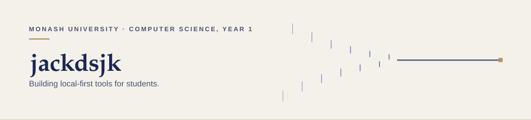
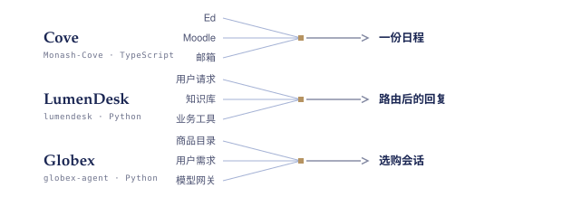

  <picture>
    <source media="(prefers-color-scheme: dark)" srcset="./assets/hero-dark.svg">
    
  </picture>

三个项目做的是同一件事：把散落的输入，收成一件能用的东西。

  <picture>
    <source media="(prefers-color-scheme: dark)" srcset="./assets/shape-dark.svg">
    
  </picture>

### 项目

**[Monash-Cove](https://github.com/jackdsjk/Monash-Cove)** · Cove · `TypeScript` 
本地优先的校园信息分诊：把 Ed、Moodle 和邮箱里的通知与截止日期收成一份日程，桌面端装好即用，数据不出本机。四天里从 `0.1.0` 发到 `0.1.2`。

**LumenDesk** · `Python` · 仓库私有，[演示站](https://jackdsjk.github.io/lumendesk/) 
多 Agent 客服后端：意图识别、路由、RAG 和评测串在同一条链路上。

**Globex** · `Python` · 课程实战工程 
跨境电商选购 Agent，上游仓库私有。我负责模型供应商适配层：多供应商 Chat 与向量模型适配、跨网关独立凭据、上线前的供应商预检脚本与测试。

<samp><a href="https://github.com/jackdsjk">GitHub</a> · <a href="http://jackjiang.me">jackjiang.me</a></samp>

English

The same move three times: take scattered inputs, and turn them into one thing that works.

**Projects**

- **[Monash-Cove](https://github.com/jackdsjk/Monash-Cove)** — local-first campus triage. Notices and deadlines scattered across Ed, Moodle and email become one schedule; a desktop app, data stays on the machine. Three releases, `0.1.0` to `0.1.2`, in four days.
- **LumenDesk** — a multi-agent support backend: intent routing, RAG and evaluation on one chain. Private repository, [public demo](https://jackdsjk.github.io/lumendesk/).
- **Globex** — coursework project for an e-commerce shopping agent; the upstream repository is private. I built the model-provider layer: multi-provider chat and embedding adapters, separate credentials per gateway, a preflight check and its tests.

