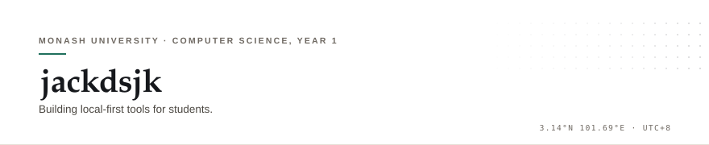

  <picture>
    <source media="(prefers-color-scheme: dark)" srcset="./assets/banner-dark.svg">
    
  </picture>

Cove 把 Ed、Moodle 和邮箱里散着的通知、截止日期和课程资料整理成一份日程，桌面上装好即用。

### 项目

**[Monash-Agent](https://github.com/jackdsjk/Monash-Agent)** · Cove · `TypeScript` 
本地优先的校园信息分诊。桌面端 + 本地服务 + 只读 MCP 接口，数据不出本机。四天里从 `0.1.0` 发到 `0.1.2`：MCP 接口、签到码 OCR、Ed 学习页。

**[QingInvest](https://github.com/jackdsjk/QingInvest)** · `TypeScript` · [在线](https://qing-invest.vercel.app) 
投资研究的阅读平台：文章库、选股器、财报与公告。Next.js + Supabase。

**LumenDesk** · `Python` · [演示站](https://jackdsjk.github.io/lumendesk/) 
多 Agent 客服后端，仓库私有。意图识别、路由、RAG 和评测串在同一条链路上。

<samp><a href="https://github.com/jackdsjk">GitHub</a> · <a href="http://jackjiang.me">jackjiang.me</a></samp>

English

Cove gathers the notices, deadlines and course material scattered across Ed, Moodle and email into a single schedule, and runs as a desktop app.

**Projects**

- **[Monash-Agent](https://github.com/jackdsjk/Monash-Agent)** — Cove, local-first campus triage. Desktop app, local service and a read-only MCP interface; data stays on the machine. Three releases, `0.1.0` to `0.1.2`, in four days.
- **[QingInvest](https://github.com/jackdsjk/QingInvest)** — a reading platform for investment research: article library, stock screener, filings. Next.js + Supabase.
- **LumenDesk** — a multi-agent support backend. Private repository, [public demo](https://jackdsjk.github.io/lumendesk/).

