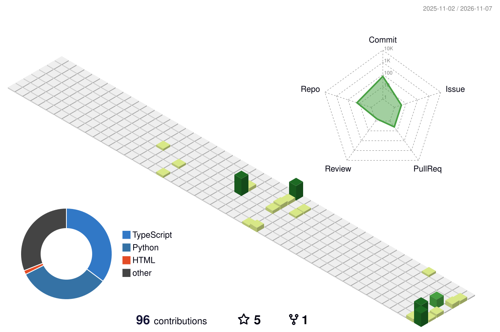

<!--
  jackdsjk — GitHub profile README
  一比一还原 MarkChu-git/MarkChu-git 的结构，只替换个人信息：
    hero 大图 → 打字行 → 学校（原为技术栈图标墙）→ 3D 贡献图 → 徽章 → 浏览量
  - hero.jpg：静态图
  - 打字行：readme-typing-svg（与参考页同一个服务、同一组参数）
  - 3D 贡献图：yoshi389111/github-profile-3d-contrib，每天由 .github/workflows/profile-3d.yml
    生成并 force-push 到 output 分支，页面只引用 raw 链接
-->

  

 

  

 

<h3>Monash University</h3>

Computer Science · since 2025

 

  

 

  
  &nbsp;
  
  &nbsp;
  

 

  

